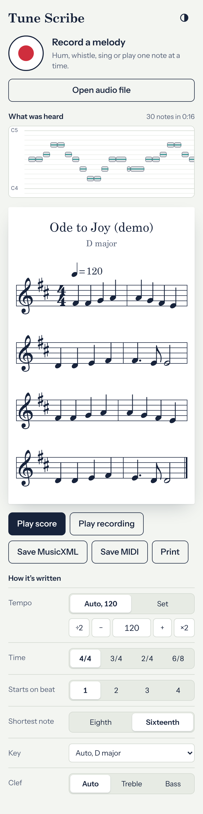

# Tune Scribe

<p align="center">
  
</p>

An installable PWA (React + TypeScript + Vite) that listens to a melody and
writes it out as sheet music.

- **Listen** — record from the microphone, or open an audio file (mp3, m4a,
  wav, ogg, flac — anything the browser can decode; drag and drop works too).
  While recording, a live pitch trace and note readout show what is being
  picked up, and a warning appears if the input is too quiet, distorting, or
  has no clear pitch. Optionally record to a click (one bar of count-in); the
  take is then written at the click's tempo instead of a detected one.
- **Read** — the tune appears as engraved notation (VexFlow): clef, key
  signature, time signature, metronome mark, real note values, rests, beams
  and ties, wrapped to the width of the screen, with a bar number at the
  start of each line and room for a composer's name.
- **Check** — play the score back on a sampled piano with the sounding note
  highlighted (at 50–125% speed, looped, with a click if wanted; repeats are
  taken), or play the original recording against it. "What was heard" shows the raw pitch
  trace with the notes it was cut into.
- **Correct** — tempo (with ÷2 / ×2 for the classic half-time/double-time
  miss), time signature (a likelier one, and the beat the tune starts on,
  are suggested when the notes point to them), shortest note value, feel
  (straight, swing, or triplets), key, transposition (semitones, or B♭ / E♭
  / F instruments) and clef. Changes re-notate instantly.
- **Edit** — tap a note to fix it alone: pitch up or down, longer or shorter
  (into the rest or note that follows, or pushing the later notes along),
  split in two, join to the next, or remove. Put a repeat sign at the start
  or end of its bar. Add a chord symbol above it or a lyric below it; in the lyric field, space or a hyphen moves to the next
  note. Everything done by hand can be undone and redone (Ctrl/Cmd+Z). With
  a note picked, the arrow keys, + / − and Delete work too.
- **Keep** — every tune is saved in IndexedDB with its audio, title, marks
  and settings. "Saved tunes" lists them; the one that was open comes back
  after a reload.
- **Take it away** — PDF, MusicXML (MuseScore, Dorico, Sibelius, Finale…),
  MIDI, or print; where the browser can share files, the PDF goes to the
  share sheet. Print and PDF set the score at page width in black on white.
  "Link" copies a URL that holds the notes, settings and marks (not the
  audio) in its fragment and opens the score in Tune Scribe; nothing is
  uploaded.

Everything runs in the browser. No audio leaves the device, and once
installed the app works offline.

## What it can and cannot hear

It follows **one note at a time**: a voice, a whistle, a flute, a violin, a
single line on the piano. Pitch detection is monophonic, so chords and
full-band mixes will not transcribe correctly — that needs a polyphonic
model (see "Where to take it next").

Also not handled yet: tuplets other than eighth-note triplets in
quarter-note time, sixteenths alongside triplets (with triplets on, the
grid is eighths and triplet eighths), applying a detected time signature by
itself (it is offered, not assumed), and adding a note where nothing was
heard (split an existing note instead).

## How it works

```
microphone ──┐
             ├─► mono PCM ─► pitch contour ─► notes ─► rhythm grid ─► bars ─► VexFlow
audio file ──┘      (1)          (2)           (3)        (4)          (5)      (6)
```

1. `audio/capture.ts` (AudioWorklet) and `audio/decode.ts` both produce plain
   mono samples, so a recording and a file take the same path from here on.
2. `audio/pitchTrack.ts` + `audio/yin.ts` — YIN pitch detection every 10 ms,
   in a Web Worker (`analysis.worker.ts`). A 5-minute track takes about 10 s
   on a laptop.
3. `transcribe/segment.ts` — corrects for the recording's overall tuning,
   smooths octave slips, splits the contour where the pitch settles somewhere
   new, and splits repeated notes at their attacks.
4. `transcribe/tempo.ts` + `quantize.ts` — finds the pulse from the gaps
   between onsets, then places notes gap by gap so a player who drifts in
   tempo stays on the grid.
5. `transcribe/key.ts` + `score.ts` — Krumhansl–Schmuckler key finding, note
   spelling for the key, and splitting into bars and readable note values.
6. `notation/renderScore.ts` — measures, beams, ties and systems in VexFlow.

Around the pipeline: `transcribe/feel.ts` holds the swing time map and the
thirds-of-a-unit arithmetic triplets need (positions are whole sixteenths or
thirds of one); `transcribe/meter.ts` scores time signatures by where the
long notes fall; `transcribe/edits.ts` and `marks.ts` apply hand corrections,
chords and lyrics after the rhythm grid (step 4), so they survive a change
of settings; `storage/library.ts` keeps the tunes in IndexedDB;
`share/link.ts` packs a tune into a URL fragment; `audio/metronome.ts` and
`audio/levelWatch.ts` are the click and the input-level advice;
`export/pdf.ts` + `export/scorePdf.ts` draw the score on a canvas page by
page and write it as a PDF of greyscale images (no PDF library).

Steps 3–5 are cheap and pure, which is why changing a setting never re-reads
the audio.

`App.tsx` only wires things together. The state and actions behind the
screen are hooks in `app/` (`useRecorder`, `usePlayback`, `useNoteTools`,
`useTunes`, `useExports`); what is on the screen is in `components/`.

## Fonts and sounds

Two sets of files in the repository are built from other people's work, by
scripts that can be run again:

- `src/notation/fonts/` — `scripts/build-fonts.py` takes the fonts VexFlow
  ships and writes them out as files: Academico as it is, and Bravura cut
  down from about four thousand glyphs to the few hundred a single melodic
  line can call for (250 kB to 41 kB). The app then loads `vexflow/core`,
  which has no fonts inside it. Both fonts are under the SIL Open Font
  License; Bravura (Steinberg) reserves its name, so the cut-down copy is
  renamed inside the file. If new notation shows up as empty boxes, its
  glyphs are in a range the script does not keep: add the range and re-run.
- `src/audio/piano/` — `scripts/build-piano.sh` takes eleven notes of the
  Salamander Grand Piano V3 by Alexander Holm (CC BY 3.0), from the
  `@audio-samples/piano-mp3-velocity8` package, and trims and re-encodes
  them to about 190 kB in all. `audio/piano.ts` shifts each by up to three
  semitones to cover the notes between; if the samples cannot be fetched,
  playback falls back to a synthesised voice.

## Relation to purrfect-pitch

The notation layer started from
[purrfect-pitch](https://github.com/pinardy/purrfect-pitch):

| Here | From | What changed |
| --- | --- | --- |
| `notation/theory.ts` | `reading/theory.ts` | ported; interval naming dropped |
| `notation/renderScore.ts` | `reading/renderScore.ts` | same SVG backend, CSS-variable staff ink and cursor highlight; now lays out measured bars over several systems and moves the highlight without re-rendering |
| `components/ScoreView.tsx` | `components/ScoreView.tsx` | same resize/theme handling; waits for VexFlow's fonts; re-lays out for print |
| `theme.tsx`, `hooks/*` | same paths | unchanged apart from storage keys |
| `scripts/generate-icons.mjs` | same path | same dependency-free PNG encoder, new artwork |

Pitch detection is new: purrfect-pitch's autocorrelation suits a tuner, but
YIN makes fewer octave errors and is cheap enough to run over a whole track.
localStorage keys are prefixed `scribe.` so both apps can live on one origin
(e.g. two GitHub Pages projects).

## Development

```sh
npm install
npm run dev      # http://localhost:5173
npm test         # pipeline tests (vitest): audio in, score out
```

`src/transcribe/pipeline.test.ts` synthesises audio, runs the whole pipeline
and checks the written notes, so detection changes can be tested without a
microphone. The "Try it with a demo tune" button runs the same synthesised
tune in the app.

## Production build

```sh
npm run build
npm run preview
```

`base` is `./`, so `dist/` can be served from a domain root or any sub-path
without changes. The service worker and manifest are generated by
`vite-plugin-pwa`. Microphone access and PWA installation need a secure
context: `localhost` in development or HTTPS in production.

`.github/workflows/deploy.yml` (the same workflow purrfect-pitch uses)
publishes `dist/` to GitHub Pages on every push to `main`.

`npm run icons` regenerates the PNG icons in `public/`.

## Where to take it next

- **Polyphonic audio** — `analyse()` in `audio/analyse.ts` is the seam: it
  takes samples and returns a pitch track. A model such as Spotify's
  basic-pitch (TensorFlow.js) could return note events directly and feed
  `arrange()`; the score model would then need chords and a second staff.
- **Editing** — `renderScore` already maps each notehead to its played note
  (`eventIndex`), which is what tap-to-fix-pitch or delete would hang off.
- **Triplets / swing**, **time-signature detection**, **pickup bars** drawn
  as true anacruses rather than leading rests.
